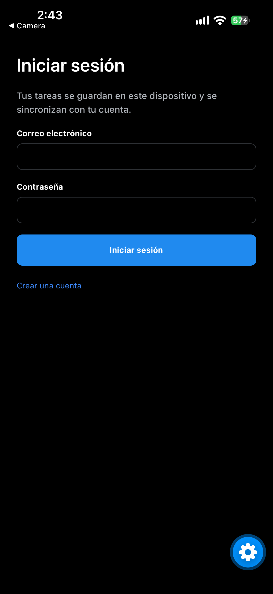
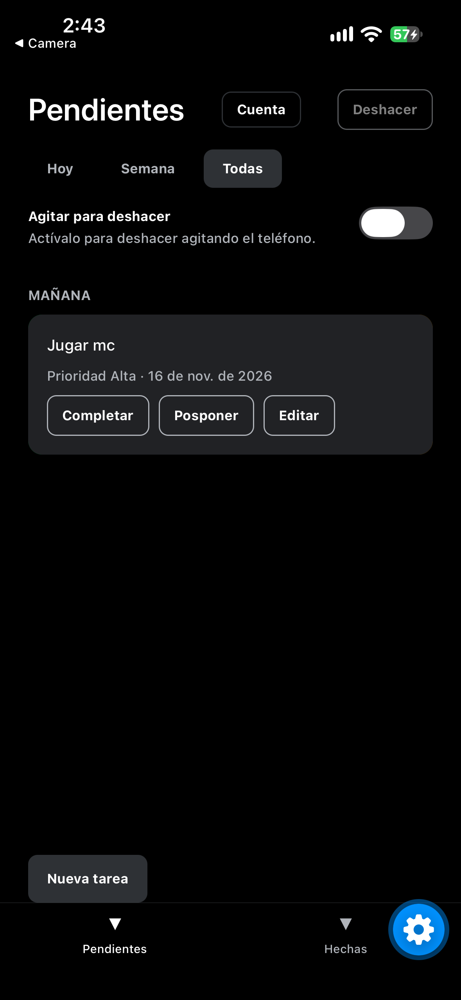
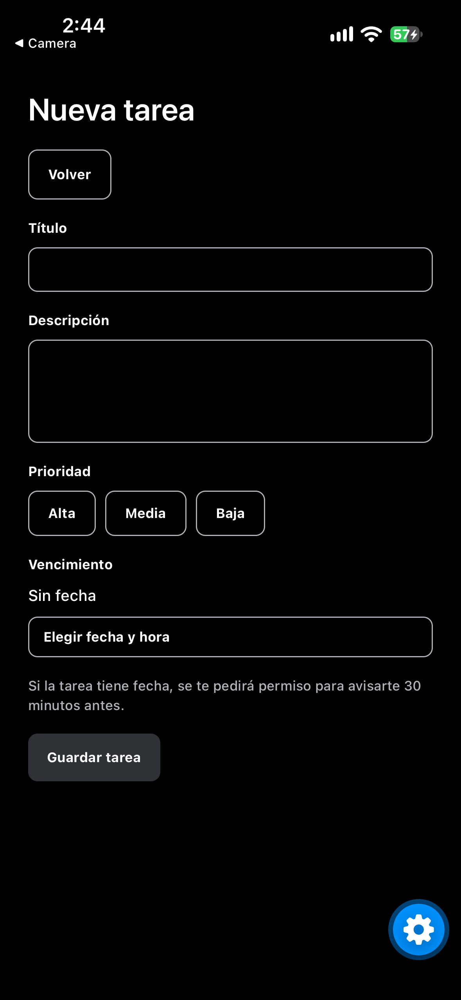
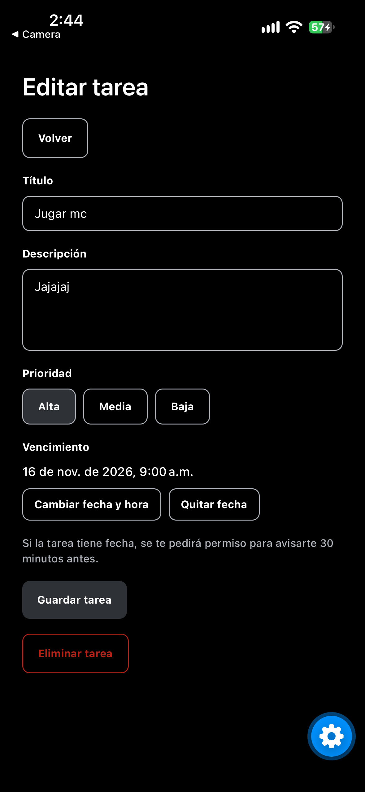
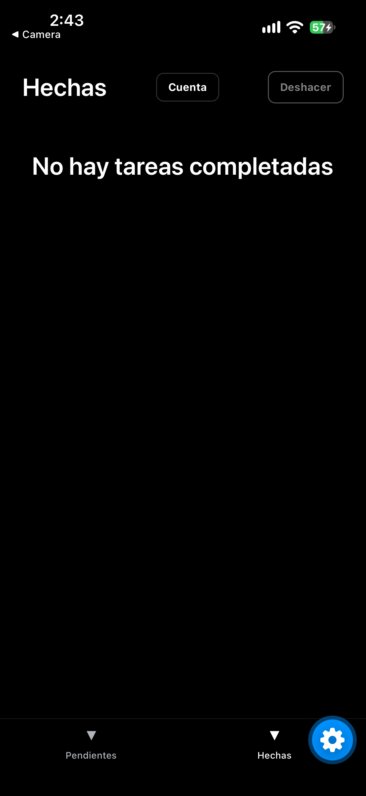
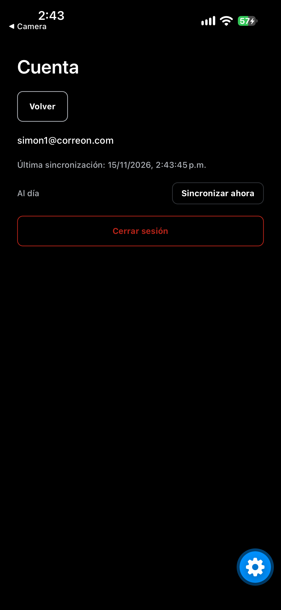

# Lista de tareas

App móvil de tareas con recordatorios locales. Expo + React Native + TypeScript +
Expo Router. Los datos viven en SQLite y se sincronizan por HTTPS con una API
Next.js desplegada en Vercel.

## Comandos

```bash
npx expo start          # desarrollo
npm run check           # typecheck + lint + formato + pruebas con cobertura
npm run test            # Jest + jest-expo + React Native Testing Library
npm run check:ia        # pruebas de la configuración de IA
npm run build           # exportación web (prueba de compilación)
```

## APK de Android

**Descarga directa:** [APK 1.0.0 (1)](https://expo.dev/artifacts/eas/DHHkFDq_MnEx0zU3ryFYu2TjM3zV5hHJvmq89P9nsxU.apk)

Build de EAS `8e381ee9-610e-4ea9-b9c6-dffde4f03793`, perfil `preview`,
Android internal distribution, commit `8adf593`. El enlace del artefacto es
público y descarga el APK directamente; la página del build puede pedir sesión
de Expo. El artefacto está disponible hasta el **29 de noviembre de 2026**; si
expira, descarga el APK y compártelo por Drive o GitHub Releases.

El perfil `preview` de `eas.json` genera el APK e inyecta la URL pública de la
API:

```bash
npx eas-cli login
npx eas-cli build -p android --profile preview
```

Para iOS se usa el mismo perfil con `--platform ios`, pero requiere cuenta de
Apple y registrar el dispositivo.

## Configuración

Crea un `.env` local (ignorado por Git) antes de probar el login:

```bash
EXPO_PUBLIC_API_URL=https://lista-de-tareas-api.vercel.app
```

Reinicia `npx expo start` después de crearlo o cambiarlo.

- `EXPO_PUBLIC_API_URL` es la única variable pública de la app. Debe ser HTTPS.
  No contiene secretos y no se versiona ningún `.env`.
- Los tokens de sesión se guardan en `expo-secure-store`, nunca en
  `AsyncStorage`.
- La app no incluye `firebaseConfig` ni credenciales de Firebase.

## Capturas

| Login                             | Pendientes                                        |
| --------------------------------- | ------------------------------------------------- |
|  |  |

| Nueva tarea                                  | Editar tarea                                   |
| -------------------------------------------- | ---------------------------------------------- |
|  |  |

| Hechas                                    | Cuenta                              |
| ----------------------------------------- | ----------------------------------- |
|  |  |

## Estructura

- `app/`: rutas de Expo Router, incluidas `(auth)/login`, `(auth)/registro` y
  `cuenta`.
- `src/api/`: cliente HTTP, configuración, errores, autenticación, tareas y
  almacenamiento seguro de la sesión.
- `src/services/`: reglas de negocio, sesión, conflictos y sincronización.
- `src/repositories/`: SQL parametrizado sobre SQLite.
- `src/providers/`: sesión, tareas y sincronización para las pantallas.
- `src/components/`: UI accesible.

## Dependencia `expo-crypto`

Se usa `Crypto.randomUUID()` de `expo-crypto` para generar el `remote_id` de
cada tarea. Ese id es la clave de idempotencia del `PUT` y el identificador del
documento en Firestore, por lo que debe ser un UUID criptográfico; no se usa un
generador propio con `Math.random`. Se agregó `expo-crypto` (`~58.0.8`) con
`npx expo install expo-crypto`; es la única dependencia nueva del bloque y quedó
justificada en `package.json` y en este README.

## Sincronización

- La app escribe primero en SQLite y marca `pending = 1`.
- Al iniciar sesión, tras cada cambio y al pulsar «Sincronizar ahora» se suben
  los pendientes con `PUT`/`DELETE` y luego se piden cambios con
  `GET /api/tareas?since=`.
- Si falla la red, el estado queda «Sin conexión» y se puede reintentar desde
  Cuenta con «Sincronizar ahora».
- Gana la última escritura comparando `updated_at` como instante. Los borrados
  son lógicos.
- `notificacion_id` es local: nunca viaja a la API.
- Si cambia el cursor de una página completa de 500 sin avanzar, la bajada se
  detiene y lo reporta; la API aún no tiene desempate por `id`.

## Privacidad local

Al cerrar sesión se borran los tokens y los datos locales tras confirmar. En el
primer login, si hay tareas de la etapa sin cuenta, la app pide confirmación y
las purga cuando el login/registro termina bien, antes de sincronizar. Si el
login falla o el usuario cancela, las tareas locales se conservan.
